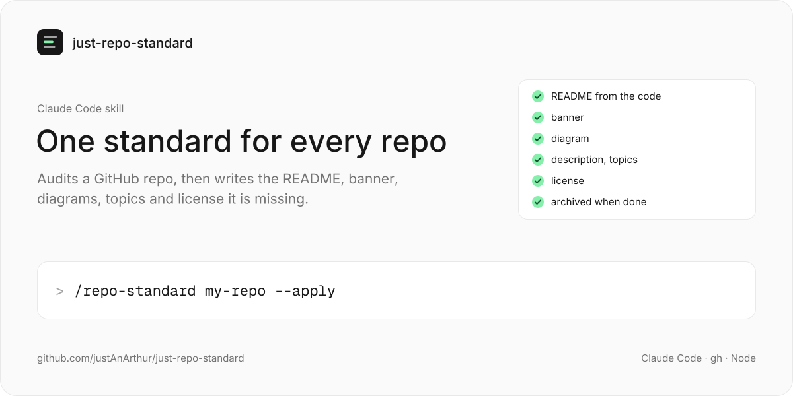
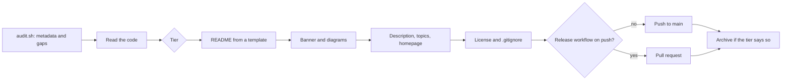

<a href="https://github.com/justAnArthur/just-standards"></a>

# just-standards

Standards for everything I run, written as packs. Each standard in a pack is a check that measures it and a recipe that fixes it. A business adopts packs. Every asset it owns (a website, a web app, a repo) is checked against them, and a failing cell goes to Claude Code, which comes back with a pull request.

**Status:** the first pack, `repo`, works today as a Claude Code skill. The CLI, the website pack and the desktop app (a [just-apps](https://github.com/justAnArthur/just-apps) app) are in progress; see the [MVP spec](docs/mvp-spec.md).

```text
packs/repo/     the repo pack: a Claude Code skill that brings a GitHub repo up to one standard
docs/           the MVP spec
```

## The repo pack

A [Claude Code](https://claude.com/claude-code) skill that brings a GitHub repo up to one standard: a README written from the code, a banner, Mermaid diagrams where the code has structure, description, topics, homepage, license, `.gitignore`, and archive state. It plans first and changes nothing on GitHub until you add `--apply`.

Built while auditing the 107 repos on this account, and the rules come from that run: coursework kept in its original language under an English summary, no license on code other people wrote, secrets reported and never printed.

### Install

```bash
git clone https://github.com/justAnArthur/just-standards ~/Projects/just-standards
```

```bash
ln -s ~/Projects/just-standards/packs/repo ~/.claude/skills/repo-standard
```

```bash
npm install --prefix ~/Projects/just-standards/packs/repo/scripts
```

Requirements:

- `gh`, logged in with the `repo` scope (`gh auth status`)
- `git` and Node 18+
- `rsvg-convert` to preview banners as PNG (`brew install librsvg`)
- network access for `npx @mermaid-js/mermaid-cli`, which checks that diagrams parse
- optional: `gitleaks`, for scanning history for secrets

Then make it yours: edit the **Configuration** table at the top of [`packs/repo/SKILL.md`](packs/repo/SKILL.md) (owner, your git author names, licenses, university topic), and the copyright holder in [`packs/repo/assets/licenses/MIT.txt`](packs/repo/assets/licenses/MIT.txt).

### Use

In Claude Code:

```text
/repo-standard my-repo                          audit and plan; changes nothing
/repo-standard my-repo --apply                  write README, banner, metadata, license; push; archive if the tier says so
/repo-standard my-repo --tier portfolio --apply pick the tier yourself
```

Plain requests work too: "standardize my-repo", "run the repo standard over all my coursework repos". For many repos, the skill works in batches and finishes one repo for you to check before doing the rest.

The two scripts also work without Claude:

```bash
# what's missing in one repo, as JSON
bash ~/.claude/skills/repo-standard/scripts/audit.sh owner/repo | jq .gaps

# render a banner from a spec (fields documented at the top of banner.mjs)
node ~/.claude/skills/repo-standard/scripts/banner.mjs references/banner-examples/flagship-modo.json banner.svg
```

### Tiers

| tier | for | gets |
|---|---|---|
| `flagship` | public, maintained | banner, full README with diagrams, description, 3–8 topics, homepage, MIT license, `.gitignore` |
| `portfolio` | public, finished: coursework, hackathons, thesis, hiring challenges | banner, portfolio README with results, CC BY-NC-ND 4.0 license, then archived |
| `private` | private, still used | short README, description |
| `notes` | study notes, vaults | one-paragraph README, description, then archived |
| `fork` | forks | a description saying what the fork is for; code untouched |
| `skip` | anything you exclude | nothing |

### How it works



Every claim in a README has to come from the code or the existing docs. When the code does something other than what the title promises, the README says what the code does.

### What it won't do

Without your confirmation for that exact repo, it never deletes a repo, changes visibility, force-pushes, rewrites history, closes or merges PRs, or touches a fork's code. It never prints secret values; it untracks them and tells you what to rotate. It adds no license where other people wrote the code.

### Structure

```text
packs/repo/SKILL.md                      configuration, tiers, procedure, guardrails
packs/repo/references/readme.md          README templates per tier
packs/repo/references/visuals.md         banner, diagram, screenshot and badge rules
packs/repo/references/topics.md          topic vocabulary and course codes
packs/repo/references/banner-examples/   two complete banner specs
packs/repo/scripts/audit.sh              one-repo audit → JSON with gaps
packs/repo/scripts/banner.mjs            banner renderer: outlined Inter / Geist Mono, light and dark in one SVG
packs/repo/assets/licenses/              MIT and CC BY-NC-ND 4.0 texts
packs/repo/assets/fonts/                 Inter and Geist Mono, with their OFL license files
```

## License

[MIT](LICENSE). The fonts in `packs/repo/assets/fonts` are under the SIL Open Font License (license files next to them). `packs/repo/assets/licenses/CC-BY-NC-ND-4.0.txt` is Creative Commons' legal code, shipped for the portfolio tier.
