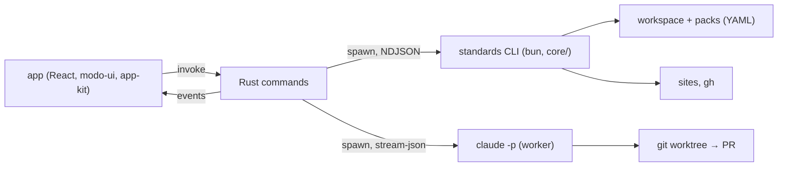

# just-standards — MVP spec

One place that says how every business I run should be built and run, measures each one
against it, and hands the gaps to an AI (or a person) to fix.

**Test bed:** the next sites going through review, redesign and build. The MVP is done when,
for each of them, I can add the business, see the grid, send a red cell to Claude Code, watch
the run, and get a PR that turns the cell green.

## 1. Repo and naming

- **Rename** `justAnArthur/just-repo-standard` to `justAnArthur/just-standards`.
  - GitHub keeps a redirect, so existing clones and links keep working.
  - The current skill becomes the `repo` pack (§4).
- **The repo is a just-apps app,** mounted as the submodule `apps/standards` in just-apps.
  - It builds only inside a just-apps checkout (`workspace:*`, `crates/app-core`), like every other app.
  - Releases follow the just-apps convention: tags `just-standards@x.y.z` and a macOS build.
- **Layout:**

```
just-standards/
  app.json, package.json, index.html, src-tauri/   just-apps app shell
  src/                                             screens (React, modo-ui, app-kit)
  core/                                            model, loaders, check runner, prompt builder (TS, no UI)
  cli/                                             `standards` CLI over core (bun)
  packs/<pack>/                                    the standards themselves (data, §4)
  docs/
```

- **The `repo-standard` skill stays installable.** `packs/repo/` keeps the `SKILL.md`, scripts,
  references and assets it has today. The README's install line becomes a symlink:
  `ln -s <checkout>/packs/repo ~/.claude/skills/repo-standard`.

## 2. Concepts

| term | meaning |
|---|---|
| **business** | Something I run: camasys, jobiflow, justanarthur (the personal brand), modo… |
| **asset** | Something a business owns, of one **kind**: `website`, `webapp`, `repo` (MVP); later `mobile`, `social`, `newsletter`, `api`. It has a URL and/or a repo, a local path and a stack. |
| **pack** | A versioned set of **items** for one or more asset kinds (Website pack, Repo pack). A business **adopts** packs. |
| **item** | One standard: a **check** (how to measure it) plus a **recipe** (how to fix it). It applies to the business's assets whose kind matches. Versioned on its own. |
| **cell** | One asset × one item. Its state comes from the last check result plus any open run or PR. |
| **worker** | Someone a cell can be given to. MVP: a Claude Code preset (profile, model, effort, permissions). Later: a person, or a just-agents agent. |
| **run** | One worker working one cell, or a batch of cells: a timeline of events that ends in a PR, a failure, or "nothing to do". |

Roles, teams, channels, escalation, waves and operations are out of scope (§10). In the MVP
an item has no owner; I pick the worker each time, from a default per business.

## 3. Files

All config is YAML in git, so I and Claude Code can both edit it.

- **Workspace folder** (a setting; default `~/Projects/justanarthur/standards-workspace`, ideally
  a private git repo):

```
standards-workspace/
  businesses/<id>.yml   business, its assets, adopted packs, default worker, waivers
  workers.yml           worker presets
  packs/                optional: my own packs, layered over the bundled ones
  .state/               gitignored: results/<business>.json, runs/<id>/{run.json,events.ndjson}
```

- **Business:**

```yaml
# businesses/camasys.yml
id: camasys
name: Camasys
assets:
  - id: site
    kind: website
    url: https://camasys.com
    repo: utegsk/camasys-web
    path: ~/Projects/uteg/camasys-web
    stack: payload-next
  - id: repo
    kind: repo
    repo: utegsk/camasys-web
packs: [website@1, repo@1]
worker: sonnet-fixer          # default; any cell can pick another
waivers:
  - item: website/og-video
    asset: site
    reason: no brand video yet
    until: 2027-01-31
```

- **Worker presets:**

```yaml
# workers.yml
- id: sonnet-fixer
  runtime: claude-code
  profile: ~/.claude             # CLAUDE_CONFIG_DIR, i.e. which account (as in ai-desktop)
  model: sonnet
  effort: medium
  permission_mode: acceptEdits
  allow: ["Bash(git *)", "Bash(gh pr *)", "Bash(bun *)", "Bash(npm *)"]
- id: opus-reviewer
  runtime: claude-code
  profile: ~/.claude
  model: opus
  effort: high
  permission_mode: plan          # reads and proposes, edits nothing
```

## 4. Packs

- **Pack definition:**

```
packs/website/
  pack.yml                       id, version, title, applies_to: [website], items, changelog
  items/og-video/
    item.yml                     id, version, title, why, applies_to, check
    recipe.md                    how to fix, per stack; given to the worker as instructions
    check.ts                     only when check.kind is script
```

- **Item:**

```yaml
# packs/website/items/og-video/item.yml
id: og-video
version: 1
title: og:video on the home page
why: link previews on LinkedIn and X play a short loop instead of a still
applies_to: [website]
check:
  kind: http
  path: /
  expect:
    - select: meta[property="og:video"]
      attr: content
      absolute_url: true
      follow: { status: 200, content_type: video/mp4, max_bytes: 8000000 }
    - select: meta[property="og:video:type"]
      attr: content
      equals: video/mp4
```

- **Check kinds:**

| kind | runs | for |
|---|---|---|
| `http` | Fetch a path of the asset's URL, then assertions on status, headers and HTML selectors; `follow` fetches a URL found on the page | meta, og, llms.txt, robots, sitemap, headers |
| `repo` | Files and globs in the asset's local path (exists, contains, json path) | LICENSE, README sections, configs |
| `github` | `gh api` on the asset's repo | description, topics, homepage, archive state |
| `script` | `check.ts` default export `(ctx) => Result` | anything the others can't express |
| `ai` | `claude -p --json-schema` with read-only tools and a cheap model, returning `{state, evidence}` | judgment: "README written from the code", "hero says what it is" |

- **Result:** `{ item, item_version, asset, state: pass|fail|error, evidence, checked_at }`.
  - `error` means it couldn't check (DNS, 500, no local path). It is never shown as red.

**MVP packs:**
- **website@1:**
  - meta basics (title, description, canonical);
  - og:image (1200×630, reachable);
  - og:video;
  - favicon + apple-touch-icon;
  - robots.txt + sitemap.xml;
  - structured data (valid JSON-LD Organization or WebSite);
  - llms.txt;
  - security headers (HSTS, X-Content-Type-Options).
- **repo@1** (from today's skill):
  - README not thin or boilerplate;
  - banner;
  - description;
  - 3–8 topics;
  - homepage that responds;
  - LICENSE per tier;
  - .gitignore;
  - no tracked `.env`.

  The recipe for all of them is the existing `SKILL.md`, so one run fixes the whole repo pack.

## 5. Architecture



- **core + CLI.** All logic lives in TypeScript under `core/`:
  - loading and validating packs and businesses (zod);
  - the check runners;
  - working out which cells apply;
  - building prompts.

  The `standards` CLI exposes it. It writes NDJSON when piped, so it serves the app, Claude Code
  and CI alike:
  - `standards check [business] [--item] [--json]`
  - `standards status [business]`
  - `standards prompt <business> <asset> <item>`
  - `standards validate`

  Checks run in bun, not the webview: no CORS, real filesystem, `gh` available.
- **Native side.** The app runs both the CLI and the Claude Code workers as processes from Rust.
  - **Claude Code sessions are already solved in ai-desktop.** Its `sessions.rs` and `profiles.rs`
    cover stream-json in and out, permission prompts surfaced to the UI through
    `--permission-prompt-tool stdio`, profiles via `CLAUDE_CONFIG_DIR`, process-group kill and
    stripping inherited `CLAUDE_*` env.
  - **Step 0: move that into the just-apps platform** before a second app copies it. That means a
    `crates/claude-session` crate, a TS package for the stream-json event model, and a host-contract
    capability or `commands<M>` typing. The just-apps rule ("a capability every app could use goes
    into the contract") asks for exactly this.
  - Running the CLI needs a small generic `process_spawn` / `process_kill` command with
    line-streamed stdout (the same pattern, without the Claude specifics).
- **Web host.** `host-web` gets mocks for these commands, so the UI runs in a browser on fixtures
  for kit work and Playwright.

## 6. Flows

1. **Add a business:** name, then assets.
   - For each asset: kind, URL, repo, local path, stack.
   - The app offers to detect the stack from the local path's `package.json`.
2. **Adopt packs:** checkboxes for the packs whose kinds the business has assets for. The app
   shows how many cells this adds.
3. **Pick a default worker:** from `workers.yml`, edited on the Workers screen.
4. **Run checks:**
   - `standards check <business>` streams results into the grid as they arrive.
   - Also "re-check this cell" and "re-check all".
   - On app start, checks run when results are older than a day.
5. **Grid:** the business's assets × the adopted items. Clicking a cell opens a drawer:
   - evidence;
   - the item's why and its check;
   - history;
   - a **Fix with ▾ [worker]** button.

   Multi-select red cells on one asset to send them as one run (one PR).
6. **Fix run:**
   - The app creates `<path>/.worktrees/std-<item>` on branch `standards/<item>` from the default
     branch.
   - It starts the worker there with a prompt made by `standards prompt`:
     - the business and asset context;
     - the item's why;
     - the failing evidence;
     - `recipe.md`;
     - the house rules: work only in this worktree; conventional commit; no AI attribution
       trailers or footers; open the PR with `gh pr create`; print its URL last.
   - Permission requests the preset doesn't allow show up in the timeline as approve/deny, so the
     run can still continue.
   - The PR URL is taken from the final message, or from `gh pr list --head`.
   - When the PR is merged, the app removes the worktree.
7. **Timeline:** one screen per run.
   - The stream-json events: assistant text, tool calls (collapsed, with diffs for edits),
     permission prompts, cost and tokens, the result, the PR card.
   - Runs are listed per business and per cell. Stop and resume (`--resume <session>`).
8. **Re-check:**
   - `repo` and `github` items re-check against the worktree or PR right away.
   - `http` items re-check after deploy: on demand, or on a Vercel preview URL when the PR has one
     (a stretch goal).
   - The cell shows "PR open" until its check passes.

## 7. Screens (MVP subset of the mockup)

The UI is designed first as a modo kit (`modo/kits/standards`), presentational and on mock data,
per the just-apps "new app" rule. The existing mockup is the reference for that kit.

1. **Businesses:** rows of businesses, columns of packs, a coverage % per cell, "not adopted"
   shown dashed. Add business.
2. **Business:** assets × items grid (states below), plus the asset list and an edit form, the
   adopted packs and the default worker.
3. **Cell drawer:** evidence, why, the check written out, history, waive (with reason and until),
   Fix with ▾.
4. **Run:** the timeline (flow 7).
5. **Runs:** all runs, filter by business, worker and state.
6. **Workers:** edit presets. Each shows its profile's account (as in ai-desktop) and the
   model/effort options.
7. **Packs:** read-only list of packs, their items and changelog. Editing happens in YAML, by me
   or by Claude.

**Cell states:**

| state | meaning |
|---|---|
| pass | The check passes. |
| pass (older version) | Passes an older version of the item; shows as a faint "v1". |
| fail | The check fails. |
| error | Couldn't check (grey, with the reason). |
| stale | No result for more than 7 days. |
| running | A worker is on it, with its initials. |
| pr open | A PR is open; shows its link. |
| waived | Waived, with a reason and an end date. |
| n/a | The item doesn't apply to this asset. |

## 8. Safety and hygiene

- **Workers only write inside their worktree.** `--add-dir` is never wider than that, and nothing
  is ever pushed to the default branch: a run's only output is a PR.
- **Presets are explicit.** No `bypassPermissions` preset in the MVP.
- **No AI attribution in commits or PRs.** It is part of every fix prompt, and the run checks the
  PR afterwards.
- **Logs are scrubbed.** Event logs never hold env values. Secrets the CLI finds (tracked `.env`)
  are reported by path, never printed.
- **Worktrees are cleaned up.** They go away on merge, or when a run is abandoned. A Runs screen
  badge flags worktrees left behind.

## 9. Milestones

| # | ships | check-point |
|---|---|---|
| M0 | Rename; move today's skill to `packs/repo`; install symlink in README | `/repo-standard` still works |
| M1 | `core/` + CLI + website@1 + repo@1; workspace with the test businesses | `standards check` gives correct results on the sites under redesign. **Usable on its own from Claude Code.** |
| M2 | Step 0: Claude session and process commands moved into the just-apps platform; ai-desktop on them | ai-desktop works unchanged |
| M3 | modo kit `standards` (screens 1–3 on mock data) | screenshots of light and dark mode reviewed |
| M4 | App: businesses, grid, drawer, checks streaming from the CLI | real grid for the test businesses |
| M5 | Fix runs: worktree, worker, timeline, permission prompts, PR, re-check, cleanup | one red cell becomes a merged PR and turns green |

M1 is useful on its own: the redesign work can lean on `standards check` before any UI exists.

## 10. Not in the MVP

- Roles and teams.
- Responsibles and channels (Slack, email, peer).
- Escalation.
- Rollout waves and automatic pack upgrades.
- Growth operations (cadences).
- Social, analytics and mobile packs.
- just-agents and human workers.
- Scheduled background checks while the app is closed.
- Multi-user use and hosting.

The data model leaves room for them: `owner_role` on items, `team` on businesses, and `runtime`
on workers.

## 11. Decisions to make

1. **Repo visibility.** just-apps app repos are private; just-repo-standard is public.
   - Recommendation: keep it public. The packs are useful to others, and nothing in it is secret,
     because businesses live in the workspace.
2. **Workspace location.** Use a separate private repo, or a folder only?
   - Recommendation: a private repo `standards-workspace`, so the config history is kept.
3. **Step 0 scope.** Extract the Claude session code into just-apps now, or copy it for the MVP
   and extract later?
   - Recommendation: extract now. It's mechanical, and the CLAUDE_* env and permission-prompt
     details are easy to get wrong in a copy.
